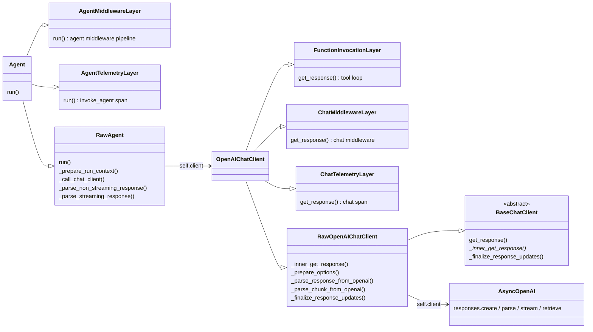
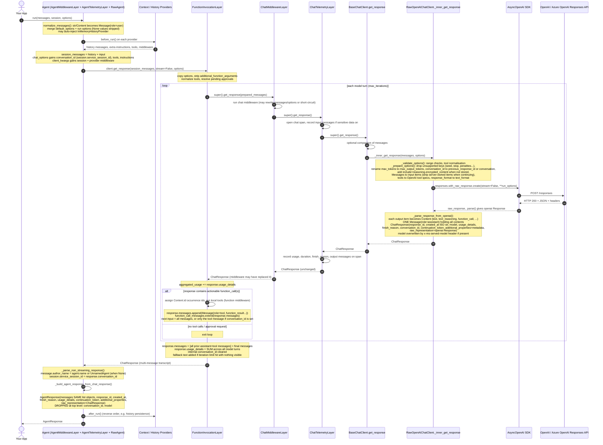
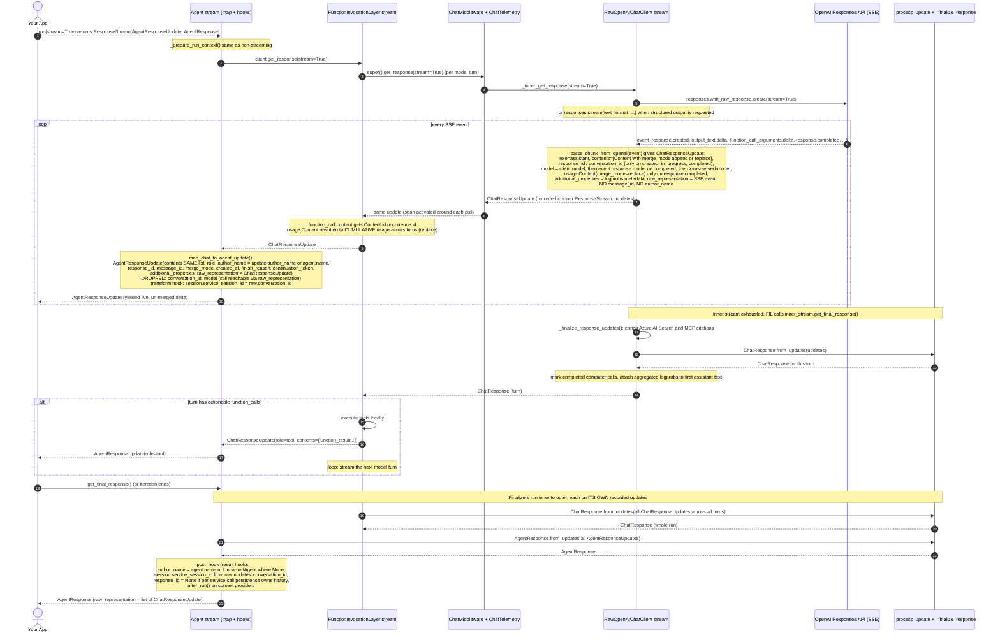
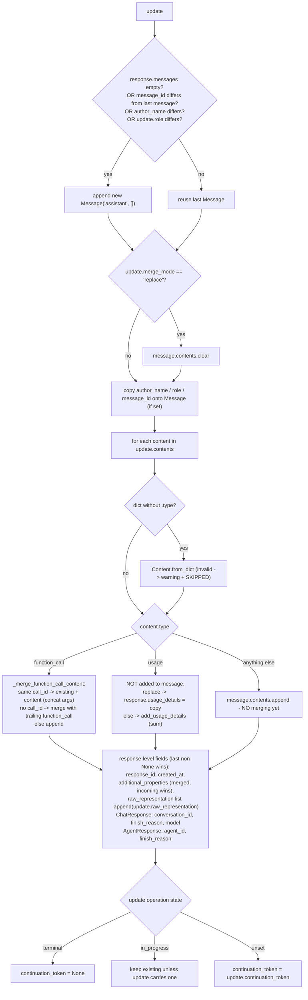

# How MAF processes provider responses (OpenAIChatClient → Agent)

Reviewed against the installed packages: `agent-framework-core 1.22.0`, `agent-framework-openai 1.17.0`, `openai 2.38.0`.
All line references below point into `.venv/Lib/site-packages/`.

> **TL;DR** – MAF never hands you the provider's raw payload directly. The OpenAI SDK object is
> **parsed into framework `Content` items** by the provider client, those are **wrapped** in
> `ChatResponse` / `ChatResponseUpdate`, **merged / coalesced** by `_process_update` +
> `_finalize_response`, **augmented** by the function-invocation loop (tool calls + results,
> aggregated usage), and finally **re-wrapped** as `AgentResponse` / `AgentResponseUpdate` by the
> `Agent` (which adds `author_name` and drops `conversation_id` / `model` from the top level).
> The original provider object is always retained in `raw_representation` (one or more levels deep).

---

## 1. Component composition

`OpenAIChatClient` is not one class doing everything; it is a stack of **mixins resolved by Python's MRO**.
Each layer's `get_response()` calls `super().get_response()`, so a call travels left → right
through the bases and the response travels back right → left.

| Class | File | Role |
|---|---|---|
| `OpenAIChatClient` | [agent_framework_openai/_chat_client.py#L4560](./.venv/Lib/site-packages/agent_framework_openai/_chat_client.py#L4560) | Public client. MRO: `FunctionInvocationLayer → ChatMiddlewareLayer → ChatTelemetryLayer → RawOpenAIChatClient → BaseChatClient`. `OTEL_PROVIDER_NAME = "openai"`. |
| `FunctionInvocationLayer` | [agent_framework/_tools.py#L5543](./.venv/Lib/site-packages/agent_framework/_tools.py#L5543) | Owns the tool-call loop: calls the model, runs local tools, re-calls the model, stitches all messages into one response. |
| `ChatMiddlewareLayer` | [agent_framework/_middleware.py#L1715](./.venv/Lib/site-packages/agent_framework/_middleware.py#L1715) | Runs chat middleware **per model call** (inside the tool loop). Pass-through if none configured. |
| `ChatTelemetryLayer` | [agent_framework/observability.py#L1894](./.venv/Lib/site-packages/agent_framework/observability.py#L1894) | OTel span + metrics per model call. **Observe-only** – does not mutate the response. Pass-through when observability is disabled. |
| `RawOpenAIChatClient` | [agent_framework_openai/_chat_client.py#L583](./.venv/Lib/site-packages/agent_framework_openai/_chat_client.py#L583) | Provider translation: MAF `Message`s → Responses API `input`, and Responses API output/events → MAF `Content`. `STORES_BY_DEFAULT = True`. |
| `BaseChatClient` | [agent_framework/_clients.py#L221](./.venv/Lib/site-packages/agent_framework/_clients.py#L221) | Abstract base. `get_response()` applies optional compaction then calls `_inner_get_response()`. Default finalizer = `ChatResponse.from_updates`. |
| `Agent` / `RawAgent` | [agent_framework/_agents.py#L1991](./.venv/Lib/site-packages/agent_framework/_agents.py#L1991) / [#L891](./.venv/Lib/site-packages/agent_framework/_agents.py#L891) | Session/context providers, option merging, and conversion `ChatResponse → AgentResponse`. |

### Instantiation (`OpenAIChatClient.__init__`)

`OpenAIChatClient.__init__` ([L4677](./.venv/Lib/site-packages/agent_framework_openai/_chat_client.py#L4677)) forwards everything to `super().__init__`, so each layer peels off its own kwargs:

1. `FunctionInvocationLayer.__init__` takes `function_invocation_configuration` + function middleware.
2. `ChatMiddlewareLayer.__init__` takes `middleware` → `self.chat_middleware`.
3. `ChatTelemetryLayer.__init__` creates token/duration histograms, sets `otel_provider_name`.
4. `RawOpenAIChatClient.__init__` ([L710](./.venv/Lib/site-packages/agent_framework_openai/_chat_client.py#L710)) calls `load_openai_service_settings(...)` which resolves env vars (`OPENAI_*` or `AZURE_OPENAI_*`) and builds an `AsyncOpenAI` / `AsyncAzureOpenAI` → stored in `self.client`. Stores `self.model`. If Azure, `OTEL_PROVIDER_NAME = "azure.ai.openai"`.
5. `BaseChatClient.__init__` ([L293](./.venv/Lib/site-packages/agent_framework/_clients.py#L293)) stores `additional_properties`, `compaction_strategy`, `tokenizer`.

> Note: `OpenAIChatClient` targets the **Responses API** (`client.responses.*`), not Chat Completions.

---

## 2. Non-streaming sequence (`await agent.run(...)`)

---

## 3. Streaming sequence (`agent.run(..., stream=True)`)

Streaming is where `_process_update` is used. Every layer wraps the stream in a `ResponseStream`
([_types.py#L4028](./.venv/Lib/site-packages/agent_framework/_types.py#L4028)), which records every update it yields
and, once exhausted, runs a **finalizer** that folds the recorded updates into a final response object.

---

## 4. `_process_update` – the merge rules

[_types.py#L2457](./.venv/Lib/site-packages/agent_framework/_types.py#L2457). Shared by `ChatResponse.from_updates` and
`AgentResponse.from_updates` (and their `from_update_generator` async twins). It is called once per update and
**mutates the response in place**. `from_updates` then calls `_finalize_response` once at the end.

### What `_process_update` changes vs. what the provider sent

| Aspect | Behaviour | Practical effect for your app |
|---|---|---|
| **Message boundaries** | New `Message` only when `message_id`, `author_name` or `role` changes. | `message_id` is optional and only present if the provider client (or your code) sets it. `OpenAIChatClient` (Responses API) leaves it `None`: the Responses API's per-item ids (`msg_…`, `fc_…`, `rs_…`) are kept per-`Content` in `additional_properties["openai"]["item_id"]` / `raw_representation`, not mapped to `message_id`. (By contrast `OpenAIChatCompletionClient` sets `message_id = chunk.id`.) With every update `role="assistant"`, *all* assistant output from one model turn (reasoning + text + tool calls) lands in **one** `Message`. A tool-result update (`role="tool"`) starts a new message; the next turn's assistant output starts another. Local ids may be added later by compaction (`msg_0`, `msg_1`, …) or the vector-store history provider (`uuid4`). |
| **Default role** | New message is created as `"assistant"` then overwritten by `update.role` if present. | Updates without a role are attributed to the assistant. |
| **`merge_mode="replace"` on the update** | Clears the current message's contents. | Rare for OpenAI (it uses *content-level* replace instead). |
| **Text / reasoning deltas** | Just **appended** as separate `Content` items here; merging is deferred to `_finalize_response`. | Intermediate state holds one `Content` per delta. |
| **Function-call argument deltas** | Merged immediately by `call_id` via `Content.__add__` (string args concatenated, dict args shallow-merged, `merge_mode="replace"` overwrites). | Parallel tool calls are kept separate by `call_id`. |
| **Usage** | **Removed** from message contents and folded into `response.usage_details` (summed, or replaced when `merge_mode="replace"`). | `UsageContent` that you saw in the stream is *not* in final `messages`. |
| **Dict contents** | Converted with `Content.from_dict`; unknown types are **logged and dropped**. | Silent data loss if a custom update carries an invalid dict. |
| **Response metadata** | `response_id`, `created_at`, `conversation_id`, `model`, `finish_reason`: **last non-None value wins**. `additional_properties` merged one level deep (incoming wins). | `model` ends up as the served model / completed-event model. |
| **`raw_representation`** | Coerced into a **list** and every update's raw object appended (including `None`). | Streaming `ChatResponse.raw_representation` = list of SSE events; streaming `AgentResponse.raw_representation` = list of `ChatResponseUpdate`. |
| **`continuation_token`** | Cleared on terminal events, retained while in progress. | Present only for background / long-running responses. |

### `_finalize_response` – post-processing after all updates

[_types.py#L2897](./.venv/Lib/site-packages/agent_framework/_types.py#L2897):

1. **`_coalesce_text_content(…, "text")`** ([L2741](./.venv/Lib/site-packages/agent_framework/_types.py#L2741)) – folds each *contiguous run* of `text` contents into one. A content with `merge_mode="replace"` resets the accumulated text (OpenAI's `response.output_text.done` carries the full text as `replace`, so the final text equals the server's final text rather than deltas + full text). Runs split when the "model output kind" changes (e.g. normal text vs **refusal**). Annotations concatenated; `additional_properties` first-chunk-wins per key; `raw_representation` becomes a flat list of the chunk raws (the **head chunk's raw is dropped**).
2. **`_coalesce_text_content(…, "text_reasoning")`** – same for reasoning, splitting on different reasoning `id`s and on reasoning-text vs reasoning-summary; keeps the latest `protected_data` (encrypted reasoning) and `status`.
3. **`_coalesce_code_interpreter_content`** – merges code-interpreter call/result chunks per `call_id`.
4. **`_coalesce_function_call_occurrences`** ([L2923](./.venv/Lib/site-packages/agent_framework/_types.py#L2923)) – merges function-call fragments sharing a `Content.id` even across messages, then **removes any message whose `contents` is empty** (e.g. the message created only by a `response.created` / usage-only update).
5. **`_clear_merge_mode`** – sets `merge_mode = None` on every content (recursively), since it is update-only state.

Structured output (`response.value`) is **lazy**: parsed on first access from the *last non-empty assistant message's text* using `response_format` (Pydantic `model_validate_json` or `json.loads`). A refusal yields `""` → `None`.

---

## 5. What gets added / removed / transformed – end-to-end ledger

### Outbound (request)

| Stage | Added | Removed / renamed |
|---|---|---|
| `RawAgent._prepare_run_context` ([_agents.py#L1523](./.venv/Lib/site-packages/agent_framework/_agents.py#L1523)) | History messages from providers; provider instructions appended to `instructions`; provider + MCP tools; `conversation_id` from `session.service_session_id`; `session` + middleware in `client_kwargs`. | `None` options stripped by `_merge_options`; internal loop marker removed. |
| `FunctionInvocationLayer.get_response` ([_tools.py#L6297](./.venv/Lib/site-packages/agent_framework/_tools.py#L6297)) | Messages are copied (caller's list not mutated). | `additional_function_arguments` removed from options. |
| `BaseChatClient.get_response` ([_clients.py#L486](./.venv/Lib/site-packages/agent_framework/_clients.py#L486)) | Compaction summaries (only when a compaction strategy / tokenizer is configured). | Compacted messages excluded. |
| `RawOpenAIChatClient._prepare_options` ([_chat_client.py#L1674](./.venv/Lib/site-packages/agent_framework_openai/_chat_client.py#L1674)) | `include: ["reasoning.encrypted_content"]` when not using service storage; `model` default from client; `instructions` passed through as the top-level Responses `instructions` field. | Drops `presence_penalty`, `frequency_penalty`, `logit_bias`, `seed`, `stop`. Renames `max_tokens → max_output_tokens`, `allow_multiple_tool_calls → parallel_tool_calls`, `conversation_id → previous_response_id` (`resp_*`) or `conversation` (`conv_*`). `response_format → text_format`. `verbosity → text.verbosity`. |
| `_prepare_message_for_openai` ([L1943](./.venv/Lib/site-packages/agent_framework_openai/_chat_client.py#L1943)) | Re-serialises reasoning items from encrypted payload (stateless mode). | When continuing a stored response: **skips** prior `function_call`, `text_reasoning`, shell/computer/MCP call items (server already has them). Local (non-hosted) approval request/response contents are never sent. |

### Inbound (response)

| Stage | Added | Removed / transformed |
|---|---|---|
| `_parse_response_from_openai` ([L3442](./.venv/Lib/site-packages/agent_framework_openai/_chat_client.py#L3442)) / `_parse_chunk_from_openai` ([L3825](./.venv/Lib/site-packages/agent_framework_openai/_chat_client.py#L3825)) | Normalised `finish_reason` (`stop`, `length`, `tool_calls`, `content_filter`); `conversation_id` (= `conversation.id` or **the response id** unless `store=False`); `continuation_token` for `queued`/`in_progress`; `usage_details` with canonical **and** `openai.*` keys (cached, reasoning tokens); citations → `Annotation` objects; refusal marked via `additional_properties`; logprobs under `additional_properties`. | OpenAI output items flattened into `Content`s in **one assistant `Message`**; `created_at` epoch → ISO-8601 string; `model` replaced by `x-ms-served-model` header (Azure). Unknown output/event types are **logged at debug and dropped**. SSE `error` events raise `ChatClientException`. |
| `RawOpenAIChatClient._finalize_response_updates` ([L1043](./.venv/Lib/site-packages/agent_framework_openai/_chat_client.py#L1043)) (stream only) | Azure AI Search / MCP citation enrichment; aggregated logprobs on first assistant text; computer calls marked completed. | — |
| `ChatTelemetryLayer` | Nothing on the response (span attributes / metrics only). | — |
| `FunctionInvocationLayer` | `Content.id` occurrence ids on function calls; `Message(role="tool")` with `function_result`s; all intermediate turns **prepended** to the final response; usage **summed across turns** (streaming: cumulative usage replace-updates + correction updates); fallback assistant text if limits hit; approval-request contents inserted next to their calls. | Internal/sentinel `conversation_id` cleared. Unexecutable calls dropped when `tool_choice="none"` after truncation. |
| `RawAgent` → `AgentResponse(Update)` | `author_name` on messages (`agent.name` or `"UnnamedAgent"`); `session.service_session_id` updated. | **`conversation_id` and `model` are not fields on `AgentResponse`/`AgentResponseUpdate`** – only reachable via `raw_representation`. `agent_id` is **not populated**. `response_id` set to `None` when per-service-call history persistence owns continuation. |

### Where to find the original provider payload

| You hold… | Path to raw OpenAI object |
|---|---|
| `AgentResponse` (non-stream) | `resp.raw_representation` → `ChatResponse` → `.raw_representation` → `openai.types.responses.Response` |
| `AgentResponse` (stream) | `resp.raw_representation` → `list[ChatResponseUpdate]` → each `.raw_representation` → SSE event object |
| `AgentResponseUpdate` | `upd.raw_representation` → `ChatResponseUpdate` → `.raw_representation` → SSE event |
| Any `Content` | `content.raw_representation` → the specific output part / item / event (merged text = list of chunk raws, minus the first) |

Serialisation note: `ChatResponse.to_dict()` excludes `raw_representation` **and** `additional_properties`; `AgentResponse.to_dict()` excludes only `raw_representation`.

---

## 6. Gotchas worth knowing when building on top of MAF

1. **Streamed updates are deltas, final response is merged.** What you print from `async for update in stream` is not the same shape as `await stream.get_final_response()` – e.g. you'll see `usage` contents and many small `text` contents in the stream, but one coalesced `text` and no `usage` content in the final messages.
2. **One assistant message per model turn** for `OpenAIChatClient` – because that client leaves `message_id` as `None` (the Responses API item ids are kept per-`Content` instead). If you need to split by output item, look at each `Content.raw_representation` / `additional_properties["openai"]["item_id"]`.
3. **`author_name` differs between stream and final** – streamed updates get `agent.name` (can be `None`); the final response backfills `"UnnamedAgent"`.
4. **`conversation_id` for the Responses API is the response id** (`resp_…`) unless a `conv_…` conversation is used, and it's `None` with `store=False`. It's stored on the session, not on `AgentResponse`.
5. **`usage_details` on the final response is the sum across every model call in the tool loop**, not just the last call.
6. **`message.text` joins text contents with a space; `response.text` joins messages with `"\n"` and strips** – and refusal text *is* included in `.text`.
7. **Unknown content dicts / OpenAI event types are silently dropped** (warning/debug log only).
8. Middleware can replace the response entirely: chat middleware sees **each model call's** `ChatResponse`; agent middleware sees the final `AgentResponse`. Telemetry never mutates.
